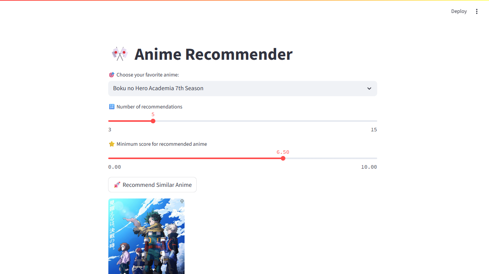

# 🎌 Anime Recommender App

An interactive anime recommendation engine built with **Streamlit** and powered by **Sentence-BERT embeddings** for semantic similarity. Pick an anime you like and get smart, relevant recommendations — filtered, ranked, and deduped automatically.



---

## ✨ Features

- 🤖 **Semantic AI matching** — uses `all-MiniLM-L6-v2` Sentence-BERT to embed anime metadata and find truly similar titles, not just genre tags
- 🎯 **Enriched embeddings** — combines Genres, Type, Studio, Source, and Synopsis into structured text for richer similarity signals
- 📊 **Blended ranking** — results ranked by 70% semantic similarity + 30% normalised score, so popular quality anime surface over obscure textual matches
- 💾 **Embedding cache** — embeddings are computed once and cached to disk; restarts are near-instant
- 🔍 **Fuzzy title matching** — typos and alternate romanisations resolve gracefully (e.g. "attack on titan" finds "Shingeki no Kyojin")
- 🚫 **Smart franchise dedup** — strips sequels, seasons, movies, and OVAs of the same franchise from results (catches "2nd Season", "Movie 3:", "GT", "Shippuuden", and more) using fuzzy partial matching on the stripped franchise root
- ⭐ **Score filtering** — filter recommendations by minimum score; over-fetches internally so you always get the requested number of results when they exist
- 🔗 Direct links to MyAnimeList pages
- 🖼️ Poster images, genres, synopsis previews, and similarity percentage per result

---

## 📁 Project Structure

```
.
├── anime_app.py              # Streamlit UI for the anime recommender
├── anime_recommender.py      # Semantic recommendation logic
├── movie_app.py              # Streamlit UI for the movie recommender (prototype)
├── movie_recommender.py      # Movie recommendation logic (prototype)
├── precompute.py             # One-time script to pre-generate embedding caches
├── data/
│   ├── anime-dataset-2026.csv
│   └── TMDB_movie_dataset_v11.csv
├── model/
│   └── all-MiniLM-L6-v2/    # Local model files (weights excluded from git)
├── requirements.txt
└── README.md
```

---

## 🛠 Installation

### 1. Get the datasets

**Anime dataset** — download from Kaggle and place at `data/anime-dataset-2026.csv`:

🔗 [Anime Dataset 2026 — Kaggle](https://www.kaggle.com/datasets/darkbarrierhub/anime-dataset-2026)

**Movie dataset** — the full 1M-row TMDB dataset is too large for practical use. The recommender already filters it down to ~28K released movies with ≥ 50 votes at load time, but the 1M-row CSV itself still takes ~10s to parse. For a smoother experience, use the **TMDB 5000 Movie Dataset** instead — it contains ~5,000 well-known movies with full metadata (genres, keywords, overview, cast) and loads instantly:

🔗 [TMDB 5000 Movie Dataset — Kaggle](https://www.kaggle.com/datasets/tmdb/tmdb-movie-metadata) *(recommended)*

🔗 [Full TMDB Movies Dataset — Kaggle](https://www.kaggle.com/datasets/asaniczka/tmdb-movies-dataset-2023-930k-movies) *(large — 1M+ rows, filter applied at runtime)*

Place the movie CSV at `data/TMDB_movie_dataset_v11.csv`.

> **Note:** if you use the TMDB 5000 dataset, column names differ slightly (`movie_id` instead of `id`, no `keywords` column in the main file). You may need to adjust `movie_recommender.py` accordingly.

### 2. Clone the repo

```bash
git clone https://github.com/TheRealVigilante/anime-recommender-app.git
cd anime-recommender-app
```

### 3. Set up environment

```bash
conda create -n dawn python=3.10
conda activate dawn
pip install -r requirements.txt
```

### 4. Download the model

The `all-MiniLM-L6-v2` model must be downloaded once and placed at `model/all-MiniLM-L6-v2/`. On a machine with HuggingFace access:

```bash
python -c "from sentence_transformers import SentenceTransformer; SentenceTransformer('all-MiniLM-L6-v2')"
```

Then copy the cached folder from `~/.cache/huggingface/hub/models--sentence-transformers--all-MiniLM-L6-v2/snapshots/<hash>/` into `model/all-MiniLM-L6-v2/`.

### 5. Pre-generate embeddings (recommended)

Run this once before launching the app to generate the embedding cache. Skips automatically on subsequent runs if the cache is already fresh.

```bash
python precompute.py
```

---

## ▶️ Running the App

```bash
conda activate dawn
streamlit run anime_app.py
```

Opens at [http://localhost:8501](http://localhost:8501).

On first run without a pre-generated cache, the app will compute embeddings on startup (a few minutes). Every run after that is near-instant.

---

## 🧠 How It Works

1. At load time, each anime's metadata is combined into a structured text string:
   `"Genres: Action, Adventure. Type: TV. Studio: Bones. Source: Manga. {synopsis}"`

2. `all-MiniLM-L6-v2` encodes all entries into 384-dimensional vectors and saves them to a joblib cache keyed by the CSV's modification time.

3. At query time, cosine similarity is computed between the selected anime's embedding and all others.

4. Results are ranked by a blended score: `0.7 × cosine_similarity + 0.3 × normalised_score`.

5. The queried anime is explicitly excluded, then franchise dedup removes all sequels/seasons/movies using fuzzy partial matching on the stripped franchise root.

6. Score filtering is applied internally, over-fetching 200 candidates to ensure the requested number of results is always returned when available.

---

## 🎬 Movie Recommender (Prototype)

A movie recommender built on the same architecture is included as a ready but untested prototype:

- **`movie_recommender.py`** — same logic as the anime recommender, adapted for the TMDB movie dataset. Filters to released movies with ≥ 50 votes at load time (~28K rows from the full 1M dataset)
- **`movie_app.py`** — dedicated Streamlit UI with a cinematic dark-gold theme
- Embedding features: Genres, Keywords, Language, Tagline, Overview
- Blended ranking, fuzzy matching, score filtering, and IMDB links all included

**Recommended dataset:** [TMDB 5000 Movie Dataset](https://www.kaggle.com/datasets/tmdb/tmdb-movie-metadata) for fast loading, or the [full 930K dataset](https://www.kaggle.com/datasets/asaniczka/tmdb-movies-dataset-2023-930k-movies) if you want broader coverage (the runtime filter handles the size).

Run with:
```bash
streamlit run movie_app.py
```

> ⚠️ The movie recommender has not been fully tested end-to-end.

---

## 👨‍💻 Author

Built with passion by [Youssef ElNahas](https://github.com/TheRealVigilante) — aka *TheVigilante*

If you have questions, ideas, or feedback — feel free to reach out!

An interactive anime recommendation engine built with **Streamlit** and powered by **Sentence-BERT embeddings** for semantic similarity. Pick an anime you like and get smart, relevant recommendations — filtered, ranked, and deduped automatically.